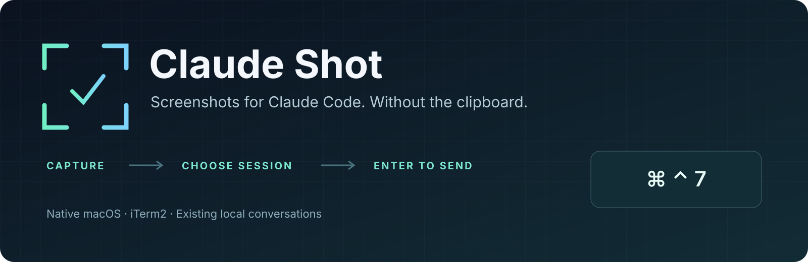
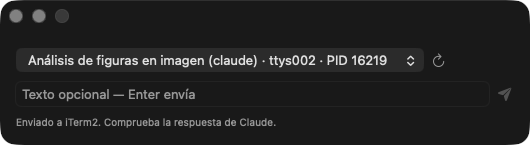
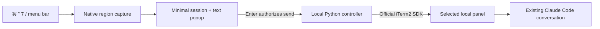

<h1 align="center">
  
</h1>

<p align="center">
  <a href="https://github.com/smart-coder-labs/claude-shot/actions/workflows/ci.yml"></a>
  
  
  
</p>

<p align="center"><strong><em>Capture a region. Choose Claude. Press Enter.</em></strong><br />Send screenshots to an existing local Claude Code conversation in iTerm2 — without copying, pasting, or starting another chat.</p>

<p align="center">
  <a href="#quick-start">Quick start</a> ·
  <a href="#see-the-app">Screenshots</a> ·
  <a href="#what-you-can-do">Features</a> ·
  <a href="#how-it-works">How it works</a> ·
  <a href="#safety-and-current-limits">Safety</a> ·
  <a href="docs/README.es.md">Español</a>
</p>

---

## A screenshot tool that stays out of your way

When you are working with Claude Code in iTerm2, a visual bug, mockup, or small UI detail should not require a clipboard round trip or a new conversation. **Claude Shot** is a native macOS menu bar app that captures a screen region and sends a local image reference to the Claude Code session you choose.

**Command + Control + 7 → capture → select a session → optional text → Enter.**

No big editor. No extra confirmation dialog. No clipboard changes.

> **Local prototype, not a fully automated safety system.** Keep the destination idle, with an empty prompt and no permission dialogs or menus. Enter authorizes transmission of the image to Claude. Session readiness is your responsibility; the app cannot reliably detect it. SSH is not supported yet.

## See the app

<p align="center">
  
</p>

<p align="center"><em>Real app-window screenshot of the single-image version after a local send, captured on the development Mac. The newer batch build adds a compact capture counter and remove/add controls. The current interface is in Spanish. No terminal or full-desktop screenshot is included.</em></p>

<details>
<summary><strong>Session selector detail</strong></summary>

<p align="center">
  
</p>

The tab title makes sessions easier to recognize. Underneath, routing uses the panel ID, TTY, PID, and process start time — **never the title or current focus alone**. This image is a crop of the same real screenshot, not a second staged product state.

</details>

## What you can do

| | Feature | What it does |
| --- | --- | --- |
| ⌘ | **Capture from anywhere** | `⌘⌃7` opens the native region selector while the app is running. |
| ◉ | **Keep your conversation** | Send to an already-open local Claude Code process in iTerm2. |
| ↗ | **Choose the right session** | Recognize tab titles, with TTY/PID to distinguish similar sessions. |
| ↵ | **Send with Enter** | Add optional single-line text in a small popup; no `ENVIAR` confirmation. |
| ▤ | **Send a capture batch** | Repeat the shortcut or press + to collect up to 6 images; Enter sends all paths in one message. |
| ⎋ | **Cancel without terminal edits** | Escape cancels region selection or discards the prepared image. |
| ◇ | **Leave the clipboard alone** | Store a private PNG and reference it by path instead of clipboard paste. |
| ⛨ | **Avoid accidental duplication** | Per-session locking, destination revalidation, broadcast suppression, and no automatic delivery retries. |

## Quick start

### 1. Build locally

You need macOS, iTerm2 with its API available, Claude Code, Python 3.11+, and an installed Apple Swift toolchain. The app targets macOS 14+, but has only been tested on the development Mac; see the [compatibility notes](docs/spike-results.md).

```bash
git clone https://github.com/smart-coder-labs/claude-shot.git
cd claude-shot

# Creates a repository-local environment and downloads the pinned dependencies.
python3 -m venv .venv
.venv/bin/python -m pip install -r requirements.lock

./scripts/build-app
open 'build/Claude Shot.app'
```

The app lives in the **menu bar**, not the Dock. Its shortcut registers automatically at launch. You can disable it or quit from the menu bar icon. It does not install itself globally or start at login.

> This is a development bundle: keep the repository and `.venv` in place. Rebuild after moving them. There is no standalone installer, signed release, or notarized download yet; the build uses a local ad-hoc signature.

### 2. Capture and send

```text
⌘⌃7                  Select a screen region
     ↓
Claude session        Choose the destination in the popup
     ↓
Optional text + ↵     Send once and hide the popup
```

1. Open **Claude Code locally in iTerm2**. Leave it idle with an empty prompt.
2. Press **Command + Control + 7** and select a region. Repeat the shortcut or press **+** in the popup to add more (up to 6). Escape during a selection cancels only that selection and preserves earlier captures.
3. Remove an unwanted image with its numbered **×** control. Choose Claude, type optional text, and press **Enter** or the paper-plane button to send the entire batch in **one message**.
4. Check the response in Claude. An iTerm2 delivery acknowledgment is not proof of visual interpretation.

Capturing does **not** transmit the image. Enter in the popup does. Empty text still sends, with a default request to describe the image. New captures append to the pending batch, preserving order and typed text. Escape in the popup discards the whole unsent batch. Limits: 6 images, 20 MiB per PNG, 60 MiB total. Visual interpretation of multiple files still needs a real acceptance test; automated tests verify the batch protocol, not model behavior.

macOS or iTerm2 may ask for capture or Automation authorization. Decide explicitly whether to grant it; the app does not enable permissions, change system settings, or answer Claude permission dialogs for you.

## How it works



The SwiftUI app communicates with the local controller through **JSON on stdin/stdout**, not user-text shell commands. The controller keeps private PNGs in capture order, revalidates the target process, and sends a single text message referencing all images plus one Enter in separate calls using the official iTerm2 SDK with `suppress_broadcast=True`.

**This is file-based visual reading, not a native attachment API.** The message contains a quoted local image path and your text. A path alone must not be treated as evidence of an attachment. Local visual reading and delivery were confirmed during the [feasibility spike](docs/spike-results.md).

## Safety and current limits

| Supported now | Not supported / not guaranteed |
| --- | --- |
| Local Claude Code in iTerm2 | SSH, tmux, containers, or other terminals |
| 1–6 PNGs in one message; optional single-line text | Multiline text; automatic guarantee that Claude reads every file |
| PNG up to 20 MiB / 40 million pixels; 60 MiB per batch | Arbitrary image formats; interlaced or non-8-bit PNG |
| Destination identity checks | Automatic detection of empty prompts, menus, or readiness |
| Explicit Enter/Send action | Safe unattended delivery or automatic retries |
| Private repository-local storage | Cloud storage, automatic consumption acknowledgments, or guaranteed timed deletion |

Images and receipts stay in `.claude-shot/` with private permissions. Receipts do not contain prompts. There is no separate screenshot upload service: when Claude reads the file, its normal provider and data policies apply.

If delivery is uncertain, inspect the destination before doing anything else. The app will not clear an existing terminal draft or repeat the same attempted operation. Private images may remain available for Claude until you explicitly clean them up:

```bash
./scripts/claude-shot cleanup   # Completed operations older than 24 hours
```

Do not clean up while a consumer still needs the image. Read the [security model and residual risks](docs/security.md).

## CLI and development

```bash
./scripts/claude-shot doctor
./scripts/claude-shot sessions
./scripts/claude-shot capture
./scripts/claude-shot capture --count 3

# Multiple PNGs, one message; text input + Enter authorize delivery.
./scripts/claude-shot send --image '/path/to/first.png' --image '/path/to/second.png'

# Tests use simulated adapters; they do not capture or send to real sessions.
.venv/bin/python -B -m unittest discover -s tests/unit -v
```

The controller/bridge suite currently has **56 passing tests**. Native build/signature verification and hotkey registration have also been checked. This is not a claim that every GUI, permission, multi-monitor, broadcast, or remote scenario has passed. Remaining acceptance checks are [listed explicitly](tests/manual/desktop.md).

## Documentation

| Guide | Contents |
| --- | --- |
| [Spanish usage guide](docs/README.es.md) | CLI, setup, capture, cleanup, and uninstall instructions |
| [Desktop architecture](docs/desktop.md) | Native app, JSON bridge, lifecycle, and error handling |
| [Security](docs/security.md) | Privacy, manual readiness, retention, and failure semantics |
| [Feasibility results](docs/spike-results.md) | Real versions, reproducible experiments, and limitations |
| [Local acceptance](tests/manual/local.md) · [Desktop acceptance](tests/manual/desktop.md) | Manual checks, including what has not yet been verified |
| [Implementation plan](IMPLEMENTATION_PLAN.md) | Original scope and accepted local UX changes |
| [Contributing](CONTRIBUTING.md) | Safe tests, documentation, and change guidelines |
| [Discoverability and publication](docs/discoverability.md) | Repository topics, asset provenance, and social-preview setup |

## Feedback and related projects

Found a macOS permission issue, hotkey conflict, or iTerm2 routing problem? [Open an issue](https://github.com/smart-coder-labs/claude-shot/issues) with versions and sanitized reproduction steps. **Do not attach private screenshots, prompts, credentials, or runtime files.**

Built by [Smart Coder Labs](https://github.com/smart-coder-labs). Related: [NexusMind](https://github.com/smart-coder-labs/nexus-mind), a shared-memory layer for AI coding agents. Claude Shot does not require NexusMind.

Claude Shot is an independent project, not an official Anthropic or iTerm2 product. No project license has been selected yet; public repository access does not itself grant a software license.
